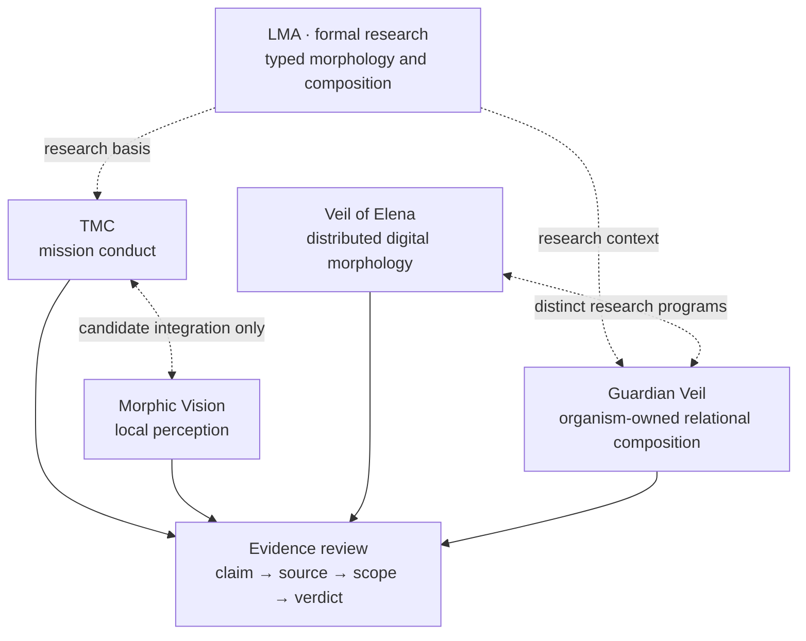

# STASYS
### Lomidze Morphological Algebra — Scientific & Technical Due Diligence

[](https://github.com/IkaRiche/LMA-Scientific-Technical-Due-Diligence/actions/workflows/validate.yml)
[Research website](https://stasysos.eu/) · [Русская версия](README_RU.md) · [Reviewer guide](docs/00_START_HERE.md) · [Focused autonomy review](docs/11_FOCUSED_AUTONOMY_REVIEW.md) · [Evidence register](evidence/CLAIMS_REGISTER.csv)

---

**An evidence-first technical index for the Lomidze Morphological Algebra (LMA) research program and its related STASYS implementations.**

LMA investigates computational systems in which the organization of typed functional elements — including spatial relations, voids, boundaries, interfaces and composition order — participates in the definition of computational transitions. This repository presents the scientific proposition, the currently documented evidence and the evidence boundaries under which public claims can be critically evaluated.

It is **not** an open-source implementation, a technology transfer package, a product announcement or a claim of deployment readiness.

## At a glance

| Area | Research focus | Evidence available | Qualification boundary |
|:--|:--|:--|:--|
| **LMA** | Formal semantics of morphological composition | Three existence results in a bounded finite model | General novelty and performance advantage remain open |
| **TMC — Terminal Mission Core** | Mission continuation through operative structure and acquired experience | Scoped software experiments; STM32H723 laboratory work | Not flight-qualified or operationally validated |
| **Morphic Vision** | Admitted local perception under degradation | Digital/host-side test results | No qualified physical sensor or validated TMC integration |
| **Veil of Elena** | Heterogeneous distributed protective morphology | 5/12-node digital studies and bounded 128-node digital composition | Not physical multi-node protection |
| **Guardian Veil — relational line** | Organism-owned local needs, LMIO and higher-order functional composition | Scoped causal digital results | Not proof of general hardware efficacy |
| **DRC / SRC** | Independent command-path admissibility and recovery | Bounded MCU-based enforcement experiments | Not safety certification |

**Commercial product selection is open.** TMC with Morphic Vision and Guardian Veil are topics of active technical and market interest, not preselected products.

## Research structure

The diagram is a **map of research relationships**, not an assertion that the components form a validated integrated system.



The two Guardian Veil programs are **distinct research lines**. The original digital-twin work contributes heterogeneity, geometry and system-level simulation; the relational line investigates local organism state, physiological interaction and higher-order composition. Their evidence must not be combined into a physical-system claim.

## Current reviewer focus (3–4 November 2026)

The prospective reviewers are interested in three **separate** mechanisms: decentralized local coordination, low-information inter-node interaction / meeting behavior, and bounded terminal mission conduct. See the [focused claim screen](docs/11_FOCUSED_AUTONOMY_REVIEW.md) and [review challenge cards](docs/12_REVIEWER_CHALLENGES.md).

The current evidence does **not** establish general coordinate-free meeting-point computation, no raw data at all layers, flight-ready terminal autonomy, or an integrated Veil–TMC product. The distinction between a tested peer-channel restriction and a generalized rendezvous system is material.

## Where to begin

| Reviewer | Start with | Then examine |
|:--|:--|:--|
| **Mathematician / formal-methods reviewer** | [LMA formal scope](docs/02_LMA_FORMAL_SCOPE.md) | [Mathematical checklist](docs/08_MATHEMATICAL_REVIEW_CHECKLIST.md) and public proof scope |
| **Autonomy / embedded systems engineer** | [TMC + Morphic Vision](docs/03_TMC_VISION.md) | [Two Guardian Veil programs](docs/04_GUARDIAN_VEIL.md) |
| **Investor / industrial evaluator** | [Research overview](docs/01_EXECUTIVE_OVERVIEW.md) | [Review protocol](docs/05_REVIEW_PROTOCOL.md) and [joint opportunity selection](docs/06_PRODUCT_SELECTION.md) |
| **Evidence / IP auditor** | [Claims register](evidence/CLAIMS_REGISTER.csv) | [Source pins](evidence/INDEX.md) and [disclosure boundary](docs/07_DISCLOSURE_BOUNDARY.md) |

For a guided reading sequence, see **[Start here: reviewer pathways](docs/00_START_HERE.md)**. The [research documentation index](docs/INDEX.md) lists the complete public package.

## How evidence is handled

1. **Claim-specific** — an observation supports only the stated configuration, intervention and measurement.
2. **Qualified** — each public claim has an explicit scope; underlying provenance stays internal to KOHI BG.
3. **Adversarially reviewable** — mathematical statements, baseline comparisons and scientific limits are explicitly separated.
4. **Controlled when necessary** — canonical proofs, source implementations, raw data and patent-sensitive materials are never supplied to external parties.

The [claims register](evidence/CLAIMS_REGISTER.csv) contains the public audit map. Source provenance remains in the internal evidence ledger; no internal repository identities or commit references are disclosed.

For detailed interpretation of terms such as *scoped evidence*, *finite-model proof* and *pending review*, see [Evidence standards](docs/10_EVIDENCE_STANDARDS.md).

## Verification

The repository contains a documentation-integrity check, not an executable implementation of LMA:

```sh
python3 tools/validate_public_package.py
```

The workflow checks required files, internal Markdown links, claim references and source-pin formatting. **A passing badge means documentation integrity only** — not formal proof verification, physical qualification or IP clearance.

## Review access and intellectual property

This is a **public overview with controlled underlying evidence**. External diligence uses claim-level summaries, non-sensitive explanations, and owner-operated demonstrations only. Private source code, full proof objects, original data and internal repositories are not shared, including under NDA.

STASYS is the research/technology identity; [stasysos.eu](https://stasysos.eu/) is the public website. **KOHI BG EOOD** is the identified legal IP-holding entity; documentary ownership and patent status must be verified in a formal transaction review.

This repository grants **no license to underlying proprietary technology**. See [Rights and limitations](LEGAL.md), [Disclosure policy](docs/07_DISCLOSURE_BOUNDARY.md), and [Responsible contact](SECURITY.md).

---

**Research snapshot:** 28 October 2026 · **Audience:** mathematical reviewers, deeptech investors, industrial evaluation partners · **First product:** not selected.
