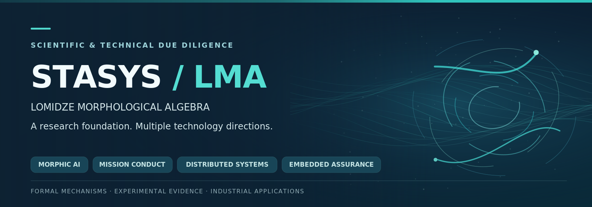
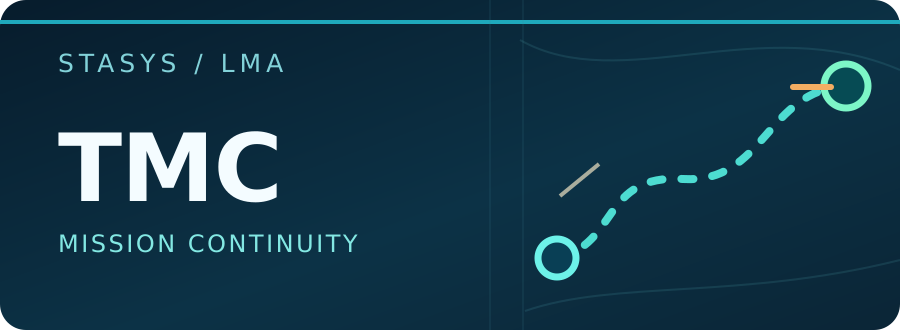
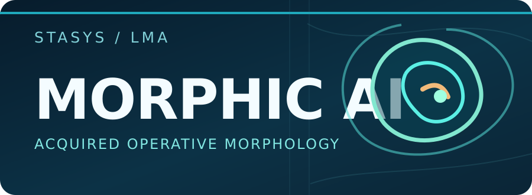
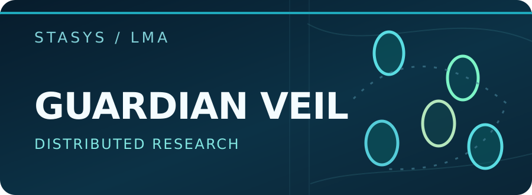
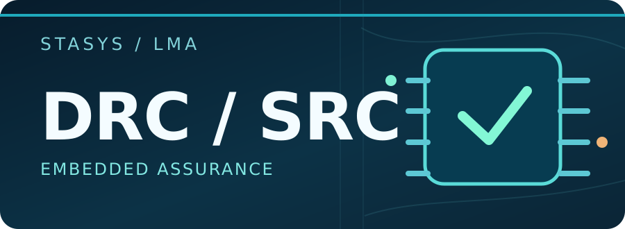
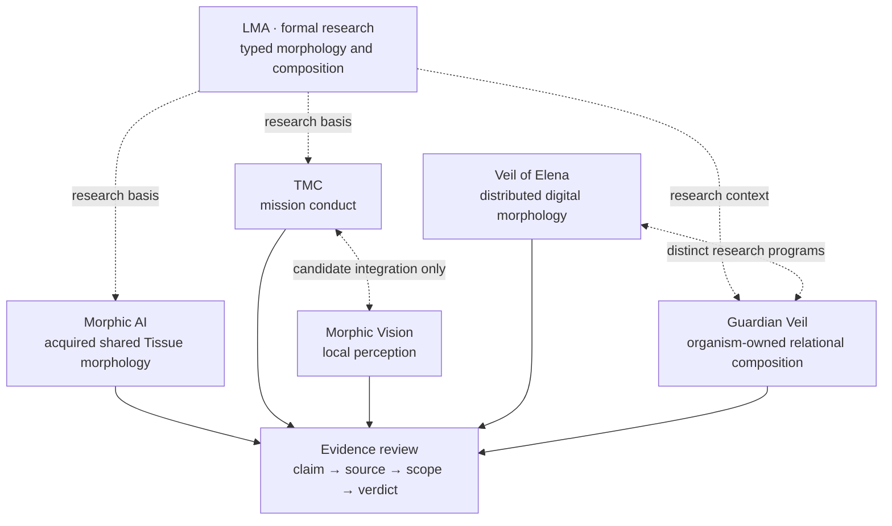

# STASYS / LMA

<p align="center"></p>

<p align="center"><strong>LOMIDZE MORPHOLOGICAL ALGEBRA</strong> · Scientific &amp; Technical Due Diligence</p>

<p align="center"><a href="README_RU.md">Русская версия</a> · <a href="docs/00_START_HERE.md">Reviewer guide</a> · <a href="docs/14_INDUSTRIAL_MISSION_CONTINUITY.md">Industrial opportunity</a> · <a href="evidence/CLAIMS_REGISTER.csv">Evidence register</a> · <a href="LEGAL.md">IP boundary</a></p>

<p align="center"><a href="https://github.com/IkaRiche/LMA-Scientific-Technical-Due-Diligence/actions/workflows/validate.yml"></a></p>

**LMA is the research foundation. STASYS explores a portfolio of distinct technology directions built upon that foundation — not a single drone product and not one already-qualified integrated system.** Each line below has its own mechanism, evidence and unresolved questions.

## Technology portfolio

<table>
<tr>
<td width="50%" valign="top">
<a href="docs/14_INDUSTRIAL_MISSION_CONTINUITY.md"></a>
<p><strong><a href="docs/14_INDUSTRIAL_MISSION_CONTINUITY.md">TMC · Mission conduct</a></strong></p>
<p>Preserving a fixed goal and deriving admissible mission intents during sequential degradation. <strong>Scoped software results and STM32H723 laboratory evidence.</strong></p>
</td>
<td width="50%" valign="top">
<a href="docs/13_MORPHIC_AI_REVIEW.md"></a>
<p><strong><a href="docs/13_MORPHIC_AI_REVIEW.md">Morphic AI · Native morphology</a></strong></p>
<p>Independently owned Prints, acquired causally operative shared morphology and bounded research on functional acquisition. <strong>Not a qualified general organism.</strong></p>
</td>
</tr>
<tr>
<td width="50%" valign="top">
<a href="docs/04_GUARDIAN_VEIL.md"></a>
<p><strong><a href="docs/04_GUARDIAN_VEIL.md">Guardian Veil · Distributed research</a></strong></p>
<p>Two distinct research lines on local interaction, functional composition and limited peer expression. <strong>Digital, not deployed physical-system evidence.</strong></p>
</td>
<td width="50%" valign="top">
<a href="docs/01_EXECUTIVE_OVERVIEW.md"></a>
<p><strong><a href="docs/01_EXECUTIVE_OVERVIEW.md">DRC / SRC · Embedded assurance</a></strong></p>
<p>Independent command-boundary and bounded recovery work, including MCU experiments. <strong>No general safety certification is implied.</strong></p>
</td>
</tr>
</table>

*All four images are conceptual branding, not operative morphology specifications, implementation diagrams or screenshots of deployed products. Morphic Vision and other tracks are covered in the [research overview](docs/01_EXECUTIVE_OVERVIEW.md).*

## Featured industrial opportunity · TMC

**The question:** Can an independently mounted mission-conduct core retain an assigned goal and derive a new permissible mission continuation when operator communications or GNSS information degrade? Geological surveys and remote pipeline inspection are candidate applications.

**The boundary:** TMC does **not** replace or modify the autopilot, localization, sensors, safety authority or executor. It cannot create missing position information. GNSS-denied real-world waypoint arrival has **not** been qualified.

| 01 · Assigned objective | 02 · First interruption | 03 · Further degradation | 04 · Mission continuation |
|:--|:--|:--|:--|
| Goal and permitted means admitted | An initial option becomes unavailable | A previously valid continuation becomes stale | TMC derives another admissible non-actuating intent — or refuses |

This sequence has a **scoped software experimental analogue**, not an end-to-end field-navigation result. [Read the industrial qualification brief](docs/14_INDUSTRIAL_MISSION_CONTINUITY.md).

## Evidence at a glance

| Formal LMA | TMC software | Embedded TMC | GNSS-denied field arrival |
|:--|:--|:--|:--|
| Three finite-model scoped existence results | Scoped goal-preserving conduct and causal controls | STM32H723 bench traces; later raw review pending | **NOT ESTABLISHED** |

> [!NOTE]
> **Research integrity and IP.** CI checks documentation integrity, not scientific proof. No private source, canonical proof objects, raw evidence or implementation license is provided here. Results from one research line do not qualify another. [Evidence standards](docs/10_EVIDENCE_STANDARDS.md) · [Disclosure boundary](docs/07_DISCLOSURE_BOUNDARY.md).

**Start here:** [8-slide technical showcase (RU)](assets/STASYS_Technical_Capability_Showcase_RU_v3.pdf) · [Industrial TMC brief](docs/14_INDUSTRIAL_MISSION_CONTINUITY.md) · [Research overview](docs/01_EXECUTIVE_OVERVIEW.md) · [Scientific evidence](evidence/CLAIMS_REGISTER.csv) · [Joint product selection](docs/06_PRODUCT_SELECTION.md)

---

## Visual capability showcase (8 slides, Russian)

[**View the STASYS technical capability showcase (PDF)**](assets/STASYS_Technical_Capability_Showcase_RU_v3.pdf) — visual explanations of distributed local decisions, bounded LMIO peer communication, and TMC mission continuity with an STM32H723 evidence overview. **These are conceptual technical illustrations, not screenshots of a deployed operator UI or evidence of field-ready autonomy.** The underlying experimental scope and limits are recorded below.

## At a glance

| Area | Research focus | Evidence available | Qualification boundary |
|:--|:--|:--|:--|
| **LMA** | Formal semantics of morphological composition | Three existence results in a bounded finite model | General novelty and performance advantage remain open |
| **Morphic AI — native Print/Tissue research** | Locally homeostatic Prints, acquired operative shared morphology and retained function | Source-integrated three-Print research; scoped prospective shared-structure causal cut | Full joint task, organism-level endogenous decision and FSM advantage not established |
| **TMC — Terminal Mission Core** | Mission continuation through operative structure and acquired experience | Scoped software experiments; STM32H723 laboratory work | Not flight-qualified or operationally validated |
| **Morphic Vision** | Admitted local perception under degradation | Digital/host-side test results | No qualified physical sensor or validated TMC integration |
| **Veil of Elena** | Heterogeneous distributed protective morphology | 5/12-node digital studies and bounded 128-node digital composition | Not physical multi-node protection |
| **Guardian Veil — relational line** | Organism-owned local needs, LMIO and higher-order functional composition | Scoped causal digital results | Not proof of general hardware efficacy |
| **DRC / SRC** | Independent command-path admissibility and recovery | Bounded MCU-based enforcement experiments | Not safety certification |

Morphic AI is a **distinct foundational research track**, not a demonstrated companion-computer replacement, and its current scientific ceiling must not be inferred from TMC/Veil results. See [Morphic AI scientific screen](docs/13_MORPHIC_AI_REVIEW.md).

**Commercial product selection is open.** The priority industrial opportunity for these discussions is TMC-supported mission continuity under communications and GNSS degradation, without transferring navigation or flight-control responsibility to TMC. It is one possible starting point for LMA commercialization, not a definition of the LMA platform or a commitment to sell the entire IP portfolio. Morphic AI, Morphic Vision, Guardian Veil, DRC/SRC and other LMA-derived lines retain distinct research goals and qualification requirements.

## Research structure

The diagram is a **map of research relationships**, not an assertion that the components form a validated integrated system.



The two Guardian Veil programs are **distinct research lines**. The original digital-twin work contributes heterogeneity, geometry and system-level simulation; the relational line investigates local organism state, physiological interaction and higher-order composition. Their evidence must not be combined into a physical-system claim.

## Current reviewer focus (3–4 November 2026)

The prospective reviewers are interested in three **separate** mechanisms: decentralized local coordination, low-information inter-node interaction / meeting behavior, and bounded terminal mission conduct. See the [focused claim screen](docs/11_FOCUSED_AUTONOMY_REVIEW.md) and [review challenge cards](docs/12_REVIEWER_CHALLENGES.md).

The current evidence does **not** establish general coordinate-free meeting-point computation, no raw data at all layers, flight-ready terminal autonomy, or an integrated Veil–TMC product. The distinction between a tested peer-channel restriction and a generalized rendezvous system is material.

## Where to begin

| Reviewer | Start with | Then examine |
|:--|:--|:--|
| **Mathematician / formal-methods reviewer** | [LMA formal scope](docs/02_LMA_FORMAL_SCOPE.md) | [Morphic AI causal morphology screen](docs/13_MORPHIC_AI_REVIEW.md) and [mathematical checklist](docs/08_MATHEMATICAL_REVIEW_CHECKLIST.md) |
| **Autonomy / embedded systems engineer** | [TMC + Morphic Vision](docs/03_TMC_VISION.md) | [Two Guardian Veil programs](docs/04_GUARDIAN_VEIL.md) |
| **Investor / industrial evaluator** | [Industrial mission continuity](docs/14_INDUSTRIAL_MISSION_CONTINUITY.md) | [Research overview](docs/01_EXECUTIVE_OVERVIEW.md) and [joint opportunity selection](docs/06_PRODUCT_SELECTION.md) |
| **Evidence / IP auditor** | [Claims register](evidence/CLAIMS_REGISTER.csv) | [Source pins](evidence/INDEX.md) and [disclosure boundary](docs/07_DISCLOSURE_BOUNDARY.md) |

For a guided reading sequence, see **[Start here: reviewer pathways](docs/00_START_HERE.md)**. The [research documentation index](docs/INDEX.md) lists the complete public package.

## How evidence is handled

1. **Claim-specific** — an observation supports only the stated configuration, intervention and measurement.
2. **Qualified** — each public claim has an explicit scope; underlying provenance stays internal to KOHI BG.
3. **Adversarially reviewable** — mathematical statements, baseline comparisons and scientific limits are explicitly separated.
4. **Controlled when necessary** — canonical proofs, source implementations, raw data and patent-sensitive materials are never supplied to external parties.

The [claims register](evidence/CLAIMS_REGISTER.csv) contains the public audit map. Source provenance remains in the internal evidence ledger; no internal repository identities or commit references are disclosed.

For detailed interpretation of terms such as *scoped evidence*, *finite-model proof* and *pending review*, see [Evidence standards](docs/10_EVIDENCE_STANDARDS.md).

## Verification

The repository contains a documentation-integrity check, not an executable implementation of LMA:

```sh
python3 tools/validate_public_package.py
```

The workflow checks required files, internal Markdown links, claim references and source-pin formatting. **A passing badge means documentation integrity only** — not formal proof verification, physical qualification or IP clearance.

## Review access and intellectual property

This is a **public overview with controlled underlying evidence**. External diligence uses claim-level summaries, non-sensitive explanations, and owner-operated demonstrations only. Private source code, full proof objects, original data and internal repositories are not shared, including under NDA.

STASYS is the research/technology identity; [stasysos.eu](https://stasysos.eu/) is the public website. **KOHI BG EOOD** is the identified legal IP-holding entity; documentary ownership and patent status must be verified in a formal transaction review.

This repository grants **no license to underlying proprietary technology**. See [Rights and limitations](LEGAL.md), [Disclosure policy](docs/07_DISCLOSURE_BOUNDARY.md), and [Responsible contact](SECURITY.md).

---

**Research snapshot:** 30 October 2026 · **Audience:** mathematical reviewers, deeptech investors, industrial evaluation partners · **First product:** not selected.
