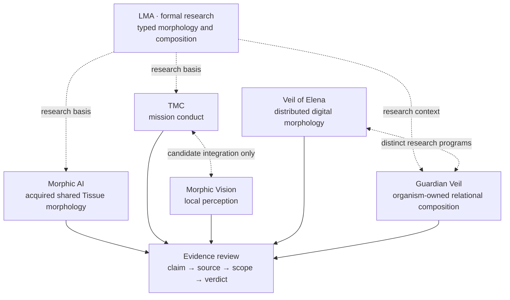

# STASYS
### Lomidze Morphological Algebra — Scientific & Technical Due Diligence

[](https://github.com/IkaRiche/LMA-Scientific-Technical-Due-Diligence/actions/workflows/validate.yml)
[Research website](https://stasysos.eu/) · [Русская версия](README_RU.md) · [Reviewer guide](docs/00_START_HERE.md) · [Focused autonomy review](docs/11_FOCUSED_AUTONOMY_REVIEW.md) · [Evidence register](evidence/CLAIMS_REGISTER.csv)

---

**Lomidze Morphological Algebra (LMA) is the foundational research program; STASYS is a portfolio of possible technology applications, not a single drone product.**

The program already has distinct, evidence-bounded research and engineering lines in morphology-native computation, acquired operative memory, autonomous mission conduct, perception, distributed coordination and independent runtime assurance. **TMC is one prospective commercial embodiment among several** — the immediate industrial diligence focus because the prospective partner highlighted a concrete problem. Progress in one line does not validate the others.

### Current industrial opportunity: mission continuity under degraded navigation and communications

**Industrial focus:** TMC investigates how an autonomous robot or drone can retain its assigned mission and derive permissible continuations after loss of GNSS or operator communication, using trustworthy observations already available from its existing onboard systems. TMC does not replace the autopilot, localization or sensors, and it does not command actuators. Reaching a physical waypoint without GNSS remains an explicitly unqualified end-to-end objective, not an accomplished field result.

**For industrial and investment reviewers:** [Mission continuity opportunity brief](docs/14_INDUSTRIAL_MISSION_CONTINUITY.md) — geology, pipeline inspections, evidence, integration responsibilities and the proposed qualification gate.

**Scientific foundation:** Lomidze Morphological Algebra (LMA) and associated STASYS implementations are presented below with their measured evidence and qualification limits.

LMA investigates computational systems in which the organization of typed functional elements — including spatial relations, voids, boundaries, interfaces and composition order — participates in the definition of computational transitions. This repository presents the scientific proposition, the currently documented evidence and the evidence boundaries under which public claims can be critically evaluated.

It is **not** an open-source implementation, a technology transfer package, a product announcement or a claim of deployment readiness.

## Visual capability showcase (8 slides, Russian)

[**View the STASYS technical capability showcase (PDF)**](assets/STASYS_Technical_Capability_Showcase_RU_v3.pdf) — visual explanations of distributed local decisions, bounded LMIO peer communication, and TMC mission continuity with an STM32H723 evidence overview. **These are conceptual technical illustrations, not screenshots of a deployed operator UI or evidence of field-ready autonomy.** The underlying experimental scope and limits are recorded below.

## At a glance

| Area | Research focus | Evidence available | Qualification boundary |
|:--|:--|:--|:--|
| **LMA** | Formal semantics of morphological composition | Three existence results in a bounded finite model | General novelty and performance advantage remain open |
| **Morphic AI — native Print/Tissue research** | Locally homeostatic Prints, acquired operative shared morphology and retained function | Source-integrated three-Print research; scoped prospective shared-structure causal cut | Full joint task, organism-level endogenous decision and FSM advantage not established |
| **TMC — Terminal Mission Core** | Mission continuation through operative structure and acquired experience | Scoped software experiments; STM32H723 laboratory work | Not flight-qualified or operationally validated |
| **Morphic Vision** | Admitted local perception under degradation | Digital/host-side test results | No qualified physical sensor or validated TMC integration |
| **Veil of Elena** | Heterogeneous distributed protective morphology | 5/12-node digital studies and bounded 128-node digital composition | Not physical multi-node protection |
| **Guardian Veil — relational line** | Organism-owned local needs, LMIO and higher-order functional composition | Scoped causal digital results | Not proof of general hardware efficacy |
| **DRC / SRC** | Independent command-path admissibility and recovery | Bounded MCU-based enforcement experiments | Not safety certification |

Morphic AI is a **distinct foundational research track**, not a demonstrated companion-computer replacement, and its current scientific ceiling must not be inferred from TMC/Veil results. See [Morphic AI scientific screen](docs/13_MORPHIC_AI_REVIEW.md).

**Commercial product selection is open.** The priority industrial opportunity for these discussions is TMC-supported mission continuity under communications and GNSS degradation, without transferring navigation or flight-control responsibility to TMC. It is one possible starting point for LMA commercialization, not a definition of the LMA platform or a commitment to sell the entire IP portfolio. Morphic AI, Morphic Vision, Guardian Veil, DRC/SRC and other LMA-derived lines retain distinct research goals and qualification requirements.

## Research structure

The diagram is a **map of research relationships**, not an assertion that the components form a validated integrated system.



The two Guardian Veil programs are **distinct research lines**. The original digital-twin work contributes heterogeneity, geometry and system-level simulation; the relational line investigates local organism state, physiological interaction and higher-order composition. Their evidence must not be combined into a physical-system claim.

## Current reviewer focus (3–4 November 2026)

The prospective reviewers are interested in three **separate** mechanisms: decentralized local coordination, low-information inter-node interaction / meeting behavior, and bounded terminal mission conduct. See the [focused claim screen](docs/11_FOCUSED_AUTONOMY_REVIEW.md) and [review challenge cards](docs/12_REVIEWER_CHALLENGES.md).

The current evidence does **not** establish general coordinate-free meeting-point computation, no raw data at all layers, flight-ready terminal autonomy, or an integrated Veil–TMC product. The distinction between a tested peer-channel restriction and a generalized rendezvous system is material.

## Where to begin

| Reviewer | Start with | Then examine |
|:--|:--|:--|
| **Mathematician / formal-methods reviewer** | [LMA formal scope](docs/02_LMA_FORMAL_SCOPE.md) | [Morphic AI causal morphology screen](docs/13_MORPHIC_AI_REVIEW.md) and [mathematical checklist](docs/08_MATHEMATICAL_REVIEW_CHECKLIST.md) |
| **Autonomy / embedded systems engineer** | [TMC + Morphic Vision](docs/03_TMC_VISION.md) | [Two Guardian Veil programs](docs/04_GUARDIAN_VEIL.md) |
| **Investor / industrial evaluator** | [Industrial mission continuity](docs/14_INDUSTRIAL_MISSION_CONTINUITY.md) | [Research overview](docs/01_EXECUTIVE_OVERVIEW.md) and [joint opportunity selection](docs/06_PRODUCT_SELECTION.md) |
| **Evidence / IP auditor** | [Claims register](evidence/CLAIMS_REGISTER.csv) | [Source pins](evidence/INDEX.md) and [disclosure boundary](docs/07_DISCLOSURE_BOUNDARY.md) |

For a guided reading sequence, see **[Start here: reviewer pathways](docs/00_START_HERE.md)**. The [research documentation index](docs/INDEX.md) lists the complete public package.

## How evidence is handled

1. **Claim-specific** — an observation supports only the stated configuration, intervention and measurement.
2. **Qualified** — each public claim has an explicit scope; underlying provenance stays internal to KOHI BG.
3. **Adversarially reviewable** — mathematical statements, baseline comparisons and scientific limits are explicitly separated.
4. **Controlled when necessary** — canonical proofs, source implementations, raw data and patent-sensitive materials are never supplied to external parties.

The [claims register](evidence/CLAIMS_REGISTER.csv) contains the public audit map. Source provenance remains in the internal evidence ledger; no internal repository identities or commit references are disclosed.

For detailed interpretation of terms such as *scoped evidence*, *finite-model proof* and *pending review*, see [Evidence standards](docs/10_EVIDENCE_STANDARDS.md).

## Verification

The repository contains a documentation-integrity check, not an executable implementation of LMA:

```sh
python3 tools/validate_public_package.py
```

The workflow checks required files, internal Markdown links, claim references and source-pin formatting. **A passing badge means documentation integrity only** — not formal proof verification, physical qualification or IP clearance.

## Review access and intellectual property

This is a **public overview with controlled underlying evidence**. External diligence uses claim-level summaries, non-sensitive explanations, and owner-operated demonstrations only. Private source code, full proof objects, original data and internal repositories are not shared, including under NDA.

STASYS is the research/technology identity; [stasysos.eu](https://stasysos.eu/) is the public website. **KOHI BG EOOD** is the identified legal IP-holding entity; documentary ownership and patent status must be verified in a formal transaction review.

This repository grants **no license to underlying proprietary technology**. See [Rights and limitations](LEGAL.md), [Disclosure policy](docs/07_DISCLOSURE_BOUNDARY.md), and [Responsible contact](SECURITY.md).

---

**Research snapshot:** 30 October 2026 · **Audience:** mathematical reviewers, deeptech investors, industrial evaluation partners · **First product:** not selected.
