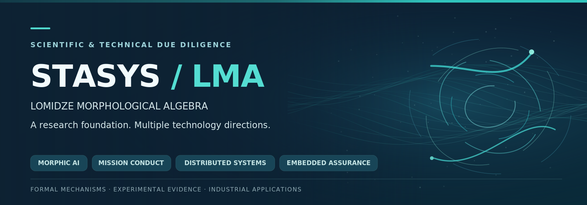

# STASYS / LMA



**Lomidze Morphological Algebra (LMA)** — фундаментальная формальная и экспериментальная исследовательская программа морфологически обусловленных вычислений. **STASYS** исследует разные технологические применения LMA: это не один продукт для беспилотников и не единая уже квалифицированная система.

**Приоритет текущего промышленного обсуждения:** может ли самостоятельное бортовое ядро TMC сохранять назначенную цель и формировать допустимые продолжения миссии при потере связи с оператором и деградации GNSS? **TMC не заменяет автопилот, навигацию, сенсоры или независимый исполнительный контур.** Физическое достижение точки без GNSS остаётся отдельной задачей интеграционной квалификации.

[**Презентация · 8 слайдов**](assets/STASYS_Technical_Capability_Showcase_RU_v3.pdf) · [**Промышленный сценарий TMC**](docs/14_INDUSTRIAL_MISSION_CONTINUITY.md) · [**Обзор исследований**](docs/01_EXECUTIVE_OVERVIEW.md) · [**Реестр доказательств**](evidence/CLAIMS_REGISTER.csv) · [**English**](README.md)

[](https://github.com/IkaRiche/LMA-Scientific-Technical-Due-Diligence/actions/workflows/validate.yml) · [Сайт STASYS](https://stasysos.eu/)

| Научная основа | Приоритетное прикладное направление | Другие направления |
|:--|:--|:--|
| **LMA / Morphic AI** · типизированная морфология, независимые Prints, приобретаемая функциональная Tissue | **TMC** · ограниченное ведение миссии, причинные программные результаты и лабораторные испытания STM32H723 | **Guardian Veil / Morphic Vision / DRC-SRC** · распределённая координация, восприятие и встраиваемая защита |

**Граница доказательств:** конечные математические результаты, цифровые и программные эксперименты, а также аппаратные трассы имеют разные области применимости. Пакет не утверждает готовность к эксплуатации, универсальную навигацию без GNSS, доступную внешнему рецензенту независимую репликацию закрытого кода или общее превосходство над обычными контроллерами.

---

## Наглядная презентация: 8 слайдов

[**STASYS — технические сценарии и исследовательские результаты (PDF)**](assets/STASYS_Technical_Capability_Showcase_RU_v3.pdf) — распределённая автономность, межузловые сигналы LMIO и ведение миссии TMC, включая результаты STM32H723. **Это технические иллюстрации, а не скриншоты рабочего операторского интерфейса или доказательство готовности к полевой эксплуатации.** Доказательные ограничения представлены ниже.

## Исследовательские направления

| Направление | Содержание | Установленный уровень |
|:--|:--|:--|
| **LMA** | Формальные структуры и композиционные операторы | Три ограниченные теоремы существования в конечной модели |
| **Morphic AI** | Независимые Prints, эндогенный гомеостаз, приобретённая общая морфология Tissue и функции | Интегрированные программные результаты для трёх Prints и ограниченное причинное вмешательство в общую структуру; полный организм и совместная задача не доказаны |
| **TMC** | Бортовое ведение миссии с причинной памятью | Программные эксперименты и испытания STM32H723 |
| **Morphic Vision** | Локальное восприятие при деградации наблюдений | Ограниченные цифровые эксперименты; аппаратная камера не квалифицирована |
| **«Вуаль Елены»** | Неоднородные автономные узлы, геометрия и цифровой двойник | Исследования на 5/12 узлах и цифровая композиция до 128 узлов |
| **Guardian Veil — реляционная линия** | Собственные состояния организмов, LMIO, HOLT/HOLO | Ограниченные цифровые причинные результаты |
| **DRC / SRC** | Независимая проверка команд и восстановление | Аппаратные испытания в ограниченных конфигурациях |

**Morphic AI — самостоятельный фундаментальный исследовательский трек, а не готовый продукт или надстройка над LLM.** Получены ограниченные результаты причинной роли приобретённой общей морфологии; не доказаны универсальная самореконфигурация, эффективность относительно FSM и автономное выполнение задач в реальном мире. См. [научную проверку Morphic AI](docs/13_MORPHIC_AI_REVIEW.md).

**TMC — один из перспективных продуктов семейства LMA, выбранный для предметной технической оценки по текущему промышленному запросу.** Morphic Vision, Guardian Veil и другие направления не сводятся к TMC. Их интеграция и коммерческий продукт ещё не выбраны. Физическая эффективность против конкретных высокоскоростных угроз не установлена.

## Специальная техническая проверка (3–4 ноября 2026)

Предмет интереса потенциальных рецензентов: **децентрализованное взаимодействие**, **межузловая координация без пересылки координат** и **ведение миссии до терминального условия**. Это три разных утверждения с разной доказательной базой. См. [проверку механизмов](docs/11_FOCUSED_AUTONOMY_REVIEW.md) и [контрольные вопросы](docs/12_REVIEWER_CHALLENGES.md).

Не доказаны: универсальный расчёт точки встречи только через LMIO, отсутствие любых пространственных измерений, единая работающая физическая система Вуаль+TMC и эксплуатационная готовность.

## Как читать

- [Обзор программы](docs/01_EXECUTIVE_OVERVIEW.md) — что создано и исследуется.
- [Математическая основа LMA](docs/02_LMA_FORMAL_SCOPE.md) — определения, формальные результаты и ограничения.
- [Morphic AI: текущие эксперименты и нерешённые вопросы](docs/13_MORPHIC_AI_REVIEW.md) — приобретённая морфология, память Tissue, контроли FSM, границы доказательств.
- [TMC + Morphic Vision](docs/03_TMC_VISION.md) — что проверено отдельно и что ещё требует интеграции.
- [Обе линии Guardian Veil](docs/04_GUARDIAN_VEIL.md) — различия между программами и их экспериментальная база.
- [Реестр доказательств](evidence/CLAIMS_REGISTER.csv) и [версии источников](evidence/INDEX.md) — прослеживаемость утверждений.
- [Математическая экспертиза](docs/08_MATHEMATICAL_REVIEW_CHECKLIST.md) и [общий протокол DD](docs/05_REVIEW_PROTOCOL.md) — порядок независимого исследования.
- [Совместный выбор продукта](docs/06_PRODUCT_SELECTION.md) — предмет будущего обсуждения с партнёрами.
- [Ограничения публичного раскрытия](docs/07_DISCLOSURE_BOUNDARY.md) — условия предоставления закрытых материалов.

Полный [каталог документов](docs/INDEX.md) и [пояснения по уровням доказательств](docs/10_EVIDENCE_STANDARDS.md) доступны отдельно.

## Проверка целостности

```sh
python3 tools/validate_public_package.py
```

Автоматическая проверка контролирует структуру документации, внутренние ссылки и реестр источников. **Она не является доказательством математической новизны, подтверждением физической эффективности или патентной экспертизой.**

## Права и доступ

STASYS — технологический бренд, [stasysos.eu](https://stasysos.eu/) — сайт. KOHI BG EOOD — указанное юридическое лицо — держатель IP; титул на конкретные объекты и статус заявок подтверждаются отдельно при due diligence.

Полные доказательства, исходные реализации и оригинальные экспериментальные данные не передаются внешним лицам, в том числе под NDA. Возможны только общие пояснения и демонстрации, полностью проводимые правообладателем. См. [условия](LEGAL.md) и [порядок раскрытия](docs/07_DISCLOSURE_BOUNDARY.md).

**Срез исследований:** 30 октября 2026 года. Первый коммерческий продукт не выбран.
